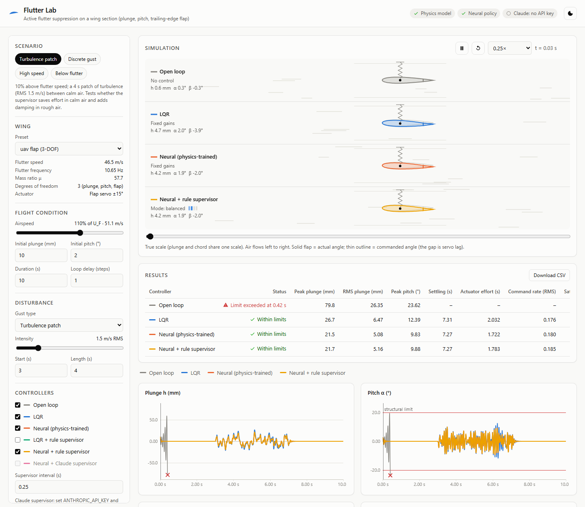

# Flutter Lab

[](https://github.com/ksaihavish/flutter-lab/actions/workflows/ci.yml)

**Active flutter suppression on a wing section (plunge, pitch and trailing-edge flap).
A validated physics model, classical (LQR, LQG) and physics-trained neural controllers, and an LLM
supervisor (a local model or Claude), with an interactive web simulator.**



## Quick start

**Windows:** double-click **`start.bat`**. The first run creates a Python environment and
installs dependencies (a few minutes); later runs start in seconds. Your browser opens at
<http://127.0.0.1:8000>.

**macOS / Linux:** `./start.sh`

**Manual:**
```bash
python -m venv .venv && .venv/Scripts/activate    # macOS/Linux: source .venv/bin/activate
pip install -e ".[llm,dev]"          # add ,train to retrain neural policies (installs PyTorch)
python -m flutter_ai serve
```

**Docker:** `docker compose up --build`, then open <http://127.0.0.1:8000>.

**Optional: the LLM supervisor.** By default it uses a local model through [Ollama](https://ollama.com)
(`ollama pull llama3.1:8b`). To use Claude instead, copy `.env.example` to `.env`, set
`FLUTTER_AI_LLM_BACKEND=claude` and `ANTHROPIC_API_KEY`, and restart.

## What you can do

| Command | What it does |
|---------|--------------|
| `start.bat` / `python -m flutter_ai serve` | Web app: animated wing with a moving flap, controller comparison, charts, flutter diagram, supervisor log, CSV export |
| `start.bat -Test` / `python -m pytest` | 82 tests, including physics validation against textbook values, an independent p-k method and thin-airfoil theory |
| `python -m flutter_ai evaluate --preset uav_flap` | Full benchmark → `outputs/uav_flap/results.json` + 9 publication figures (~20 s) |
| `python -m flutter_ai analyze --preset uav_flap` | Flutter speed, p-k cross-validation, V-g diagram |
| `python -m flutter_ai train --preset uav_flap` | Retrain the neural policy through the differentiable physics (~5 min, CPU) |
| `python -m flutter_ai validate` | Compare the model with NASA's BACT wind-tunnel flutter measurements → `outputs/validation/bact.json` |
| `python -m flutter_ai check-data data/<folder>` | Validate an experimental dataset and compare predicted vs measured flutter speed ([data/README.md](data/README.md)) |

Presets: `uav_flap` (3-DOF, default), `bact` (NASA's BACT wind-tunnel model, from published data), `uav_section` (2-DOF),
`hodges_pierce` (textbook validation case).

## How it works

- **The wing.** A typical section (plunge h, pitch α, trailing-edge flap β) with unsteady
  Theodorsen aerodynamics (Wagner function, Jones approximation), written as an exact
  discrete-time state-space model.
- **Validation.** The flutter speed matches an independent p-k analysis with the exact
  Theodorsen function to within 1 %. The flap loads match classical thin-airfoil theory.
- **Controllers (200 Hz, 5 ms loop delay).** They command the flap through a ±15° servo:
  - a **delay-aware discrete LQR**;
  - an **LQG**: LQR plus a turbulence model and a Kalman filter that estimates the gust;
  - a **neural policy** trained by back-propagating through the physics, with randomised delay,
    airspeed and turbulence.
- **Supervisor (every 0.25 s).** A supervisor reads a plain-language situation report and picks
  a mode (efficient / balanced / aggressive / emergency). It is either rule-based, or an LLM (local via Ollama, or Claude)
  with schema-constrained output and automatic fallback. The LLM never commands the flap directly.

**Current findings** (from `outputs/uav_flap/results.json`, 2026-09-29, 20 seeds; details in [docs/Memory.md](docs/Memory.md)):
- The neural policy beats plain LQR (turbulence RMS plunge 6.10 ± 0.91 vs 7.10 ± 0.81 mm, -16 %,
  20 seeds, Wilcoxon p < 0.001), but **LQG beats the neural policy** (3.71 ± 0.93 mm; neural +72 %) and has
  the lowest cost J in every scenario on every wing. LQR's weakness was a missing gust model, not something learning fixed.
- Neither supervisor (rules, or a local LLM) improves on a well-chosen fixed setting. A local 8B model answers in
  ~4 s, too slow to react to gusts: the LLM needs a slower job (see docs/Memory.md).

## Validated against NASA wind-tunnel data

The `bact` preset is built from NASA's published measurements of the **Benchmark Active Controls Technology**
wind-tunnel model (a rigid wing on a pitch-and-plunge mount with a trailing-edge flap; NASA/TP-1998-206270).
`python -m flutter_ai validate` compares the prediction with the measured flutter point:

| | Flutter dynamic pressure | Flutter frequency |
|---|---|---|
| **Measured in NASA's Transonic Dynamics Tunnel** (Mach 0.77) | ≈ 148 psf | ≈ 4 Hz |
| NASA's own model (measured + CFD aerodynamic derivatives) | 150.8 psf | 4.16 Hz |
| **This model** (modified strip theory with measured lift/moment slopes) | 183 psf (+24 %) | 3.99 Hz (−0.2 %) |
| This model, plain 2D Theodorsen | 167 psf (+13 %) | 4.13 Hz (+3 %) |

The flutter *frequency* is predicted almost exactly. The flutter *pressure* is overpredicted because the
unsteady aerodynamics are incompressible, while the test ran at Mach 0.77. That limitation is stated
openly and is the next modelling target.

## Development workflow

- `pip install -e ".[llm,dev]"`, then `pre-commit install`: lint and hygiene hooks run before every commit.
- Every push and pull request runs **CI** (`.github/workflows/ci.yml`): ruff; tests on Linux and Windows;
  a benchmark smoke run whose figures are uploaded as a downloadable artifact; and a Docker build with a health check.
- Dependabot opens weekly dependency-update PRs.

## Documentation

| Doc | Purpose |
|-----|---------|
| [docs/PRD.md](docs/PRD.md) | What we're building, for whom, research questions |
| [docs/Architecture.md](docs/Architecture.md) | System flow, physics, modules, folder structure, tech stack |
| [docs/Rules.md](docs/Rules.md) | Integrity rules, libraries, error handling, LLM safety, AI-assistant rules |
| [docs/Phases.md](docs/Phases.md) | Roadmap: paper → showcase app → hardening → commercial |
| [docs/Design.md](docs/Design.md) | Colours, theme, typography, chart and animation rules |
| [docs/Memory.md](docs/Memory.md) | Current state, latest results, decisions log, next steps |
| [docs/Study-Guide.md](docs/Study-Guide.md) | **What to study to fully understand and own this project**: 8 tracks, exercises, self-checks, 16-week plan |
| [data/README.md](data/README.md) | Which datasets to collect and the file format |
| [docs/research/](docs/research/) | Audit of the original code; corrected paper outline |

## Project history

The original research scripts are preserved in [`legacy/`](legacy/). They contained
critical bugs; see [docs/research/audit-2026-09.md](docs/research/audit-2026-09.md). **Do
not cite results from the legacy files.**
