# Fast models decide, the language model explains: fault-tolerant supervision for active flutter suppression with a fair benchmark and a dwell-time guarantee

*Draft generated 2026-11-07T10:38+00:00 by `python -m flutter_ai paper` (flutter_ai 0.3.0, commit b268a6c). Numbers and comparisons are computed from the result files; edit the prose in `src/flutter_ai/paper.py`, never the numbers here. Author list, affiliations and target venue: to be decided by the owner (see `submission-checklist.md`).*

## Abstract

When a fault develops in flight, a flutter-suppressed wing needs a supervisor that picks a safe response in time and cannot itself destabilise the loop. Language models are increasingly proposed for this supervisory role; we test that proposal on active flutter suppression and compare it with a supervisor built from fast learned and physics models. A validated typical-section model with a servo-driven trailing-edge flap, a realistic actuator slew-rate limit (545 °/s) and a 5 ms loop delay is controlled by LQR, a turbulence-aware LQG and a neural policy trained through differentiable simulation, all minimising the same cost, with the classical designs tuned for the actual actuator on data disjoint from the test set. Over 20 randomised runs per scenario the neural policy beats LQR in 3 of 4 scenarios but LQG in 0 of 4. A local 8-billion-parameter model supervising controller aggressiveness answers in 5.4 s (median), far slower than the gusts it would have to react to, and changes the cost by less than 1 % in every scenario. Supervisors choose only among pre-verified modes, and switching between the inner-loop controllers is provably stable (small-signal, nominal wing) when switches are at least 6.5 s apart on average, a condition the architecture enforces. Under six slowly developing mid-flight faults, the on-board LLM kept 27 % of faulty flights from flutter against 48 % for hand-written rules, exact McNemar p = 0.0026; no supervision kept 19 % and an oracle that knows the fault 100 %. In a pre-registered test on fresh seeds, an on-board flutter-margin estimate helped the rules (63 % vs 54 % of faulty flights survived) and hurt the LLM (2 % vs 28 %). A supervisor built from fast models instead (a learned fault diagnoser and the physics estimate extended with control authority, no language model) survived 93 % of faulty flights on fresh seeds, against 51 % for the rules (exact McNemar p < 0.001) and 100 % for the oracle. Off the control path, the same language model's explanations of a physics-informed supervisor's decisions passed a faithfulness check in 85 % of its valid answers. As a post-flight reviewer it named the true fault in 1 of 4 valid hypotheses, and a verification gate accepted 0 of 4 retrained diagnosers, so no unverified change reached the fast models. The evidence supports a division of labour: fast, verifiable models make the decision, and the language model explains it.

## 1. Introduction

Flutter is a dynamic aeroelastic instability: above a critical airspeed the aerodynamic forces feed energy into coupled structural modes and the oscillation grows until the structure fails. Active flutter suppression moves control surfaces to extend the stable envelope. It has been demonstrated in wind tunnels with classical, LQG and minimax control laws (Mukhopadhyay 1999) and with neural networks (Scott & Pado 2000; Bernelli-Zazzera et al. 2000), and learned controllers remain an active topic (Mattaboni et al. 2009; Tang et al. 2018; Tang et al. 2021; Chen et al. 2023a).

Large language models (LLMs) are now proposed as supervisory layers above fast feedback loops (Du & Chan 2026): for fault-tolerant control of process plants (Vyas et al. 2026a; Vyas et al. 2026b; Papacharalampopoulos et al. 2026), for robot skill selection (Ahn et al. 2022) and for drones, where the latency of sequential token generation is a key obstacle (Chen et al. 2023b). The survey by Du & Chan names the lack of formal stability proofs as the field's central open problem and notes that stability across LLM-triggered mode switches is largely unanalysed. We found no evaluation of an LLM supervisor for flutter suppression, and none that runs the model on board with its measured latency against rule-based and oracle supervisors, including faults the rules were not written for. We therefore ask two questions: can an on-board LLM choose among pre-verified modes better than simple rules when faults develop in flight, and if not, what should make that choice?

**Contributions.** (i) An open, validated flutter-suppression benchmark with realistic actuation and fair baselines (one shared cost; classical designs tuned for the real actuator), with a controlled comparison of LQR, LQG and a differentiable-simulation neural policy, robustness studies and ablations. (ii) A supervisory architecture above a fast, open-loop-unstable plant, building on dwell-time switching among pre-verified controllers (Papacharalampopoulos et al. 2026): a bounded mode set, a controller bank with bumpless transfer and a discrete-time dwell-time bound computed for the implemented controllers, which holds whatever the supervisor (rules, LLM or learned) answers. (iii) An evaluation of an on-board LLM as the decision-maker, with its measured latency, against no, random, rule-based and oracle supervision on two disjoint test sets, with and without an on-board flutter-margin estimate (the latter pre-registered). (iv) A guardian supervisor built from a learned fault diagnoser with an unknown-fault score and a physics-based admissibility check (flutter margin and control authority), designed on development seeds and tested once on fresh seeds, including two faults held out of its design. (v) The LLM in roles off the control path: explaining decisions, checked for faithfulness, and proposing post-flight model updates behind a verification gate. Negative results are reported as such.

## 2. Related work

*Neural flutter suppression.* A neural network scheduled the coefficients of flutter-suppression control laws over Mach number and dynamic pressure on the BACT wing (our second benchmark) in the NASA Transonic Dynamics Tunnel, where the classical systems proved more robust than the neural ones (Scott & Pado 2000). Recurrent neural networks have been used for active flutter suppression (Bernelli-Zazzera et al. 2000), and neural control has handled control-input constraints with wind-tunnel validation (Tang et al. 2021); deep reinforcement learning has been trained directly in a wind tunnel (Chen et al. 2023a). Our neural policy is trained offline through a differentiable model (Xu et al. 2022; Heeg et al. 2025); its novelty is not claimed.

*LLM supervision.* The closest work is a three-layer fault-tolerant scheme for process systems (Papacharalampopoulos et al. 2026): a cloud LLM, called once per fault event, selects one of four bounded actions over pre-verified controllers, with a rule-based fallback and an average dwell-time bound on switching, and is compared with a rule-based supervisor; its authors describe the LLM's role as advisory and as an audit record. Our architecture shares these elements. It differs in the plant (an aeroelastic system that is unstable without control, with dynamics faster than the LLM's latency), in querying an on-board model repeatedly with its measured latency applied in simulation time, and in the evaluation: random, rule-based and oracle supervisors, paired statistics over seeds, and faults described neither in the rules nor in the prompt. LLM agents that propose validated recovery actions (Vyas et al. 2026a) and LLM planning above a safety filter (Shibu et al. 2026) share our separation of a slow language layer from a fast, deterministic layer.

*Switching stability.* Switching among stable linear systems is stable if switches are slow on average (Hespanha & Morse 1999) (stated in continuous time; Section 5 gives the discrete-time counterpart we use); LQG designs have no guaranteed robustness margins (Doyle 1978), which our robustness results illustrate.

*Fault diagnosis and flutter-margin monitoring.* The guardian combines model-based fault detection and isolation with an on-line flutter-margin estimate; both are established fields, and we claim only the combination and its evaluation as a mode supervisor here. *[Owner: cite the fault detection and isolation and flight-test flutter-margin monitoring literature before submission (related-work.md §7).]*

## 3. Model and validation

The typical section has plunge h, pitch α and trailing-edge flap β (3 degrees of freedom). Unsteady aerodynamics use Theodorsen's theory (Theodorsen 1935) with a two-lag Wagner approximation in state space; the model is discretised exactly (zero-order hold) at 200 Hz. The flap is driven by a servo modelled as a second-order system (30 Hz, damping 0.56, the value measured on the BACT actuator (Waszak 1998)), a ±15° command limit and a 545 °/s slew-rate limit from a UAV servo datasheet (DSpower 2026). Every command reaches the actuator one sample later.

- **uav_flap**: flutter at 46.40 m/s, 10.43 Hz; an independent p-k analysis with the exact Theodorsen function gives 46.83 m/s (-0.93 %).
- **uav_section**: flutter at 49.22 m/s, 10.91 Hz; an independent p-k analysis with the exact Theodorsen function gives 49.59 m/s (-0.75 %).
- **bact**: flutter at 135.67 m/s, 3.99 Hz; an independent p-k analysis with the exact Theodorsen function gives 133.78 m/s (+1.41 %).
- **Wind-tunnel check:** for the NASA BACT model (Waszak 1998) the predicted flutter point is 183 psf at 3.99 Hz against ≈148 psf at ≈4 Hz measured (+24 % in dynamic pressure, -0.2 % in frequency); the pressure error is attributed to compressibility (Mach 0.77) in an incompressible model.

## 4. Controllers and fairness

All controllers minimise J = Σ (xᵀQx + c(a)·uᵀRu + ΔuᵀWΔu), with Bryson-normalised Q and R, an effort weight c(a) set by the aggressiveness a ∈ [0, 1], and a penalty W on command changes. They see the same measurements, loop delay and actuator limits.

- **LQR:** discrete-time, designed for the loop delay (command history in the state) and the rate penalty (cross term); aerodynamic lag states from an on-board observer.
- **LQG:** the same regulator on the plant augmented with a first-order (AR(1)) turbulence state, and a steady-state Kalman filter for the lag states and the gust whose input model includes the actuator's known slew-rate limit.
- **Neural policy:** a 64×64 tanh network of the state estimate, the previous command, the airspeed ratio and a; output u_max·tanh(g(x) − g(0)) so the command is zero at equilibrium. Trained by imitation of LQR, then fine-tuned through the differentiable, rate-limited plant with randomised loop delay, airspeed and turbulence.
- **Fairness:** the classical designs' free knobs (an extra rate-penalty multiplier; the Kalman filter's assumed sensor noise) are tuned for the actual actuator on episodes whose seeds never appear in the test set:
  - uav_flap: LQR rate multiplier 1; LQG rate multiplier 10, assumed sensor noise 0.001 of the reference scale.
  - uav_section: LQR rate multiplier 1; LQG rate multiplier 1, assumed sensor noise 0.001 of the reference scale.
  - bact: LQR rate multiplier 100; LQG rate multiplier 100, assumed sensor noise 0.001 of the reference scale.

## 5. Supervisory architecture

Every few seconds a supervisor (rules, the LLM or the guardian of Section 7.7) returns one mode name from a fixed enum, using only on-board information; it never outputs gains, forces or speeds. The LLM receives a plain-language status report; its answer is constrained by a JSON schema, validated again, and replaced by the rule-based decision on any failure (timeout, invalid answer, refusal, call budget). The model runs locally (Ollama, llama3.1:8b) so it works without a data link; a cloud model can be selected instead. The supervisor is asked one question at a time and its measured latency is applied in simulation time. All candidate controllers run every step on the same measurements and applied-command history (a controller bank with bumpless transfer), so switching causes no transient and all modes share one state.

**Stability of switching.** On that shared state each inner-loop controller gives a linear map ξ_(k+1) = A_i ξ_k. All are Schur-stable at every airspeed of the schedule (largest spectral radius 0.9519). With V_i = ξᵀ P_i ξ from the discrete Lyapunov equation, V_i(A_i ξ) ≤ λ V_i(ξ) and V_j ≤ μ V_i for all i, j; after k steps containing N switches V ≤ μ^N λ^k V(0), which decays whenever switches are on average more than ln μ / (−ln λ) steps apart: the discrete-time counterpart of the average dwell-time argument (Hespanha & Morse 1999). In scaled coordinates the bound is at most 6.54 s; the architecture waits at least 7 s between controller switches, so no sequence of supervisor answers can destabilise the nominal closed loop. The guarantee is small-signal and for the healthy wing: it excludes faults, saturation and the rate limit, and airspeed changes, which are slow (limited deceleration), gain-scheduled transitions; mode changes that keep the controller and only move the airspeed target are therefore not delayed. Tests check that the analysis matrices reproduce the simulators step by step.

## 6. Experiments

Four scenarios per wing: turbulence (a 4 s patch), a 1-cosine gust, the same gust at 1.3 U_F and below flutter. Deterministic gusts are randomised per seed (amplitude, length, start, initial condition). 20 seeds per scenario; paired Wilcoxon signed-rank tests and bootstrap 95 % confidence intervals on the paired differences. Disturbance sizes for uav_flap are those a 545 °/s servo can handle (turbulence 0.49 m/s RMS).

Further studies: robustness (designs for the nominal wing flying perturbed wings, sensor noise, slower actuators), ablations of the neural policy, an LLM supervising effort modes, the fault-tolerant study (Section 7.5), a pre-registered test of physics-informed supervision (7.6), a supervisor built from fast learned and physics models (7.7), and the LLM in roles off the control path (7.8). Fault-tolerant studies use disjoint seed sets: 0-19 (7.5), 100-119 (7.6), 300-319 (7.7); every design choice was made on seeds from 1000 up.

## 7. Results

### 7.1 Controllers

Cells: RMS plunge (mm, mean ± std over seeds) · mean cost J of surviving runs (lower is better) · failures.

**uav_flap**

| Scenario | Open loop | LQR | LQG | Neural |
|---|---|---|---|---|
| Turbulence, 1.1 U_F | 21.09 ± 0.00 · **20/20 failed** | 2.74 ± 0.32 · J 3.77 | 1.12 ± 0.10 · J 2.65 | 2.29 ± 0.23 · J 3.82 |
| Discrete gust, 1.1 U_F | 20.31 ± 1.52 · **20/20 failed** | 1.70 ± 0.30 · J 0.343 | 0.63 ± 0.10 · J 0.129 | 1.30 ± 0.22 · J 0.203 |
| Gust, 1.3 U_F | 26.67 ± 2.95 · **20/20 failed** | 0.48 ± 0.07 · J 0.852 | 0.99 ± 0.16 · J 0.32 | 0.72 ± 0.14 · J 0.513 |
| Gust, 0.9 U_F | 0.79 ± 0.10 · J 0.107 | 1.48 ± 0.25 · J 0.25 | 0.62 ± 0.09 · J 0.0654 | 0.81 ± 0.12 · J 0.0827 |

- The neural policy has significantly lower J than LQR in 3 of 4 scenarios and than LQG in 0 of 4.
- *Turbulence, 1.1 U_F*: lowest J without failures: **LQG**. Neural has 44 % higher cost J than LQG (95 % CI of the difference [+1.07, +1.26], Wilcoxon p < 0.001, n = 20; failures 0 vs 0 of 20).
- *Discrete gust, 1.1 U_F*: lowest J without failures: **LQG**. Neural has 57 % higher cost J than LQG (95 % CI of the difference [+0.0642, +0.0868], Wilcoxon p < 0.001, n = 20; failures 0 vs 0 of 20).
- *Gust, 1.3 U_F*: lowest J without failures: **LQG**. Neural has 60 % higher cost J than LQG (95 % CI of the difference [+0.177, +0.21], Wilcoxon p < 0.001, n = 20; failures 0 vs 0 of 20).
- *Gust, 0.9 U_F*: lowest J without failures: **LQG**. Neural has 27 % higher cost J than LQG (95 % CI of the difference [+0.0149, +0.0204], Wilcoxon p < 0.001, n = 20; failures 0 vs 0 of 20).
- Delay tolerance (ms, discrete gust): lqr 30, lqg 30, neural 15, lqr_nominal 10, lqg_nominal 10.

**uav_section**

| Scenario | Open loop | LQR | LQG | Neural |
|---|---|---|---|---|
| Turbulence, 1.1 U_F | 18.45 ± 0.00 · **20/20 failed** | 8.78 ± 0.81 · J 17 | 4.21 ± 0.42 · J 5.96 | 6.36 ± 0.66 · J 8.81 |
| Discrete gust, 1.1 U_F | 21.40 ± 2.69 · **20/20 failed** | 4.77 ± 0.73 · J 2.83 | 2.11 ± 0.32 · J 0.664 | 3.42 ± 0.55 · J 1.37 |
| Gust, 1.3 U_F | 32.20 ± 4.87 · **20/20 failed** | 6.95 ± 1.10 · J 5.66 | 2.58 ± 0.57 · J 0.973 | 5.02 ± 0.85 · J 2.82 |
| Gust, 0.9 U_F | 2.56 ± 0.35 · J 0.985 | 3.33 ± 0.50 · J 1.57 | 1.70 ± 0.24 · J 0.455 | 2.43 ± 0.37 · J 0.708 |

- The neural policy has significantly lower J than LQR in 4 of 4 scenarios and than LQG in 0 of 4.
- *Turbulence, 1.1 U_F*: lowest J without failures: **LQG**. Neural has 48 % higher cost J than LQG (95 % CI of the difference [+2.56, +3.13], Wilcoxon p < 0.001, n = 20; failures 0 vs 0 of 20).
- *Discrete gust, 1.1 U_F*: lowest J without failures: **LQG**. Neural has 105 % higher cost J than LQG (95 % CI of the difference [+0.606, +0.822], Wilcoxon p < 0.001, n = 20; failures 0 vs 0 of 20).
- *Gust, 1.3 U_F*: lowest J without failures: **LQG**. Neural has 190 % higher cost J than LQG (95 % CI of the difference [+1.63, +2.12], Wilcoxon p < 0.001, n = 20; failures 0 vs 0 of 20).
- *Gust, 0.9 U_F*: lowest J without failures: **LQG**. Neural has 56 % higher cost J than LQG (95 % CI of the difference [+0.219, +0.296], Wilcoxon p < 0.001, n = 20; failures 0 vs 0 of 20).
- Delay tolerance (ms, discrete gust): lqr 30, lqg 30, neural 15, lqr_nominal 15, lqg_nominal 15.

**bact**

| Scenario | Open loop | LQR | LQG | Neural |
|---|---|---|---|---|
| Turbulence, 1.1 U_F | 18.57 ± 0.00 · **20/20 failed** | 1.11 ± 0.13 · J 1.95 | 0.78 ± 0.15 · J 1.53 | 0.89 ± 1.38 · **1/20 failed** |
| Discrete gust, 1.1 U_F | 18.38 ± 0.96 · **20/20 failed** | 0.79 ± 0.09 · J 0.626 | 0.59 ± 0.11 · J 0.523 | 0.45 ± 0.07 · J 0.72 |
| Gust, 1.3 U_F | 18.55 ± 1.36 · **20/20 failed** | 0.79 ± 0.11 · J 1.13 | 0.74 ± 0.12 · J 1.11 | 0.46 ± 0.08 · J 1.84 |
| Gust, 0.9 U_F | 1.79 ± 0.27 · J 2.66 | 0.75 ± 0.08 · J 0.496 | 0.52 ± 0.09 · J 0.377 | 0.42 ± 0.06 · J 0.428 |

- The neural policy has significantly lower J than LQR in 1 of 4 scenarios and than LQG in 0 of 4.
- *Turbulence, 1.1 U_F*: lowest J without failures: **LQG**. Neural has 37 % higher cost J than LQG (95 % CI of the difference [+0.258, +0.914], Wilcoxon p < 0.001, n = 19; failures 1 vs 0 of 20).
- *Discrete gust, 1.1 U_F*: lowest J without failures: **LQG**. Neural has 37 % higher cost J than LQG (95 % CI of the difference [+0.135, +0.262], Wilcoxon p < 0.001, n = 20; failures 0 vs 0 of 20).
- *Gust, 1.3 U_F*: lowest J without failures: **LQG**. Neural has 66 % higher cost J than LQG (95 % CI of the difference [+0.405, +1.1], Wilcoxon p < 0.001, n = 20; failures 0 vs 0 of 20).
- *Gust, 0.9 U_F*: lowest J without failures: **LQG**. Neural has 13 % higher cost J than LQG (95 % CI of the difference [+0.0368, +0.0637], Wilcoxon p < 0.001, n = 20; failures 0 vs 0 of 20).
- Delay tolerance (ms, discrete gust): lqr 30, lqg 30, neural 15, lqr_nominal 20, lqg_nominal 20.

### 7.2 Robustness

**uav_flap**, failed runs out of 20 in turbulence:

| Condition | LQR | LQG | Neural |
|---|---|---|---|
| model error ±5 % | 2 | 1 | 1 |
| model error ±10 % | 1 | 2 | 1 |
| model error ±20 % | 9 | 0 | 7 |
| sensor noise 0 % | 0 | 0 | 0 |
| sensor noise 2 % | 1 | 2 | 0 |
| sensor noise 5 % | 12 | 7 | 6 |
| sensor noise 10 % | 20 | 18 | 20 |
| slew limit none | 0 | 0 | 0 |
| slew limit 500 °/s | 3 | 1 | 0 |
| slew limit 250 °/s | 20 | 20 | 20 |
| slew limit 125 °/s | 20 | 20 | 20 |

**uav_section**, failed runs out of 20 in turbulence:

| Condition | LQR | LQG | Neural |
|---|---|---|---|
| model error ±5 % | 0 | 0 | 0 |
| model error ±10 % | 0 | 0 | 0 |
| model error ±20 % | 7 | 0 | 1 |
| sensor noise 0 % | 0 | 0 | 0 |
| sensor noise 2 % | 0 | 0 | 0 |
| sensor noise 5 % | 0 | 0 | 0 |
| sensor noise 10 % | 0 | 0 | 0 |

**bact**, failed runs out of 20 in turbulence:

| Condition | LQR | LQG | Neural |
|---|---|---|---|
| model error ±5 % | 0 | 0 | 1 |
| model error ±10 % | 0 | 0 | 0 |
| model error ±20 % | 1 | 1 | 2 |
| sensor noise 0 % | 0 | 0 | 1 |
| sensor noise 2 % | 0 | 0 | 2 |
| sensor noise 5 % | 0 | 0 | 2 |
| sensor noise 10 % | 1 | 2 | 2 |
| slew limit none | 0 | 0 | 0 |
| slew limit 500 °/s | 0 | 0 | 0 |
| slew limit 250 °/s | 0 | 0 | 1 |
| slew limit 125 °/s | 20 | 20 | 20 |

### 7.3 Ablations (uav_flap)

| Case | Turbulence, 1.1 U_F | Discrete gust, 1.1 U_F | Gust, 1.3 U_F | Gust, 0.9 U_F | Delay tolerance |
|---|---|---|---|---|---|
| neural | J 3.82 | J 0.203 | J 0.513 | J 0.0827 | 15 ms |
| neural:imitation_only | J 4.03 (+6 % vs full) | J 0.459 (+126 % vs full) | J 0.966 (+88 % vs full) | J 0.295 (+257 % vs full) | 10 ms |
| neural:no_rate_penalty | J 3.76 (-2 % vs full) | J 0.197 (-3 % vs full) | J 0.484 (-6 % vs full) | J 0.0825 (-0 % vs full) | 15 ms |
| neural:no_airspeed | 18/20 failed (+28 % vs full) | J 0.187 (-8 % vs full) | J 0.48 (-7 % vs full) | J 1.69 (+1946 % vs full) | 10 ms |
| neural+rules | J 3.88 (+2 % vs full) | J 0.185 (-9 % vs full) | J 0.491 (-4 % vs full) | J 0.0787 (-5 % vs full) | – |
| neural+random | J 3.91 (+2 % vs full) | J 0.227 (+12 % vs full) | J 0.484 (-6 % vs full) | J 0.0857 (+4 % vs full) | – |

### 7.4 LLM supervising effort modes

llama3.1:8b (ollama): 79 decisions, 0 fallbacks, latency median 5.45 s (95th percentile 9.72 s); same mode as the rules for 68 % of reports.

- *Turbulence, 1.1 U_F*: Neural + LLM has 0 % higher cost J than neural alone (95 % CI of the difference [+0, +1.07e-15], Wilcoxon p = 1, n = 5; failures 0 vs 0 of 5).
- *Discrete gust, 1.1 U_F*: Neural + LLM has 0 % higher cost J than neural alone (95 % CI of the difference [+0, +0], Wilcoxon p = 1, n = 5; failures 0 vs 0 of 5).
- *Gust, 1.3 U_F*: Neural + LLM has 0 % higher cost J than neural alone (95 % CI of the difference [+0, +0], Wilcoxon p = 1, n = 5; failures 0 vs 0 of 5).
- *Gust, 0.9 U_F*: Neural + LLM has 0 % higher cost J than neural alone (95 % CI of the difference [+0, +0], Wilcoxon p = 1, n = 5; failures 0 vs 0 of 5).

### 7.5 Fault-tolerant supervision (uav_flap)

Modes: **nominal**: LQG at cruise; **robust**: NEURAL at cruise; **cautious**: LQG at 0.9 U_F; **safe**: LQG at 0.7 U_F. Faults start 6 s into a 30 s flight at 1.1 U_F in light turbulence and grow over 5 s:

- **servo_slew**: Flap servo slows down: slew rate 545 -> 200 deg/s.
- **stiffness_loss**: Structural damage: pitch stiffness -24 % (pitch frequency -13 %; the pitch damping coefficient follows at a constant damping ratio).
- **sensor_noise**: Sensors become noisy: noise 12 % of reference scale.
- **turbulence_rise**: Turbulence intensity x2.5.
- **loop_delay** (held out): Flight computer overload: loop delay 5 -> 15 ms.
- **flap_effectiveness** (held out): Flap damage: aerodynamic effectiveness -75 %.

Which fixed responses survive (applied 1 s after onset) and the oracle's least disruptive choice:

| Fault | nominal | robust | cautious | safe | Oracle |
|---|---|---|---|---|---|
| none | 100% | 100% | 100% | 100% | nominal |
| servo_slew | 0% | 5% | 100% | 100% | cautious |
| stiffness_loss | 100% | 0% | 0% | 70% | nominal |
| sensor_noise | 15% | 0% | 100% | 100% | cautious |
| turbulence_rise | 0% | 35% | 100% | 100% | cautious |
| loop_delay | 0% | 10% | 100% | 100% | cautious |
| flap_effectiveness | 0% | 0% | 100% | 100% | cautious |

Supervisors (20 seeds per fault, seeds 0-19; survival · mean time slowed down over the surviving flights · final mode = oracle's):

| Fault | oracle | none | rules | random | llm |
|---|---|---|---|---|---|
| none | 100% · 0.0 s · 100% | 100% · 0.0 s · 100% | 100% · 2.8 s · 75% | 100% · 11.7 s · 25% | 100% · 0.0 s · 100% |
| servo_slew | 100% · 21.6 s · 100% | 0% · – · 0% | 5% · 15.5 s · 55% | 15% · 13.1 s · 5% | 0% · – · 0% |
| stiffness_loss | 100% · 0.0 s · 100% | 100% · 0.0 s · 100% | 0% · – · 0% | 0% · – · 0% | 100% · 0.0 s · 100% |
| sensor_noise | 100% · 19.3 s · 100% | 15% · 0.0 s · 15% | 100% · 22.3 s · 80% | 0% · – · 5% | 50% · 11.3 s · 25% |
| turbulence_rise | 100% · 14.8 s · 100% | 0% · – · 0% | 70% · 18.2 s · 50% | 55% · 11.7 s · 20% | 10% · 9.6 s · 5% |
| loop_delay | 100% · 20.5 s · 100% | 0% · – · 0% | 100% · 21.8 s · 90% | 0% · – · 30% | 0% · – · 0% |
| flap_effectiveness | 100% · 22.8 s · 100% | 0% · – · 0% | 10% · 17.9 s · 40% | 15% · 12.9 s · 15% | 0% · – · 0% |

- **oracle**: 100 % of faulty flights survived (100 % on held-out faults); 0.0 s slowed down on average without a fault.
- **none**: 19 % of faulty flights survived (0 % on held-out faults); 0.0 s slowed down on average without a fault.
- **rules**: 48 % of faulty flights survived (55 % on held-out faults); 2.8 s slowed down on average without a fault.
- **random**: 14 % of faulty flights survived (8 % on held-out faults); 11.7 s slowed down on average without a fault.
- **llm**: 27 % of faulty flights survived (0 % on held-out faults); 0.0 s slowed down on average without a fault.
- llm vs rules: survived only with the first 20, only with the second 45 (exact McNemar p = 0.0026); time slowed -10.7 s over the 12 flights both survived (Wilcoxon p < 0.001).
- llm vs none: survived only with the first 9, only with the second 0 (exact McNemar p = 0.0039); time slowed +1.4 s over the 23 flights both survived (Wilcoxon p = 0.11).
- rules vs none: survived only with the first 54, only with the second 20 (exact McNemar p < 0.001); time slowed +22.3 s over the 3 flights both survived (Wilcoxon p = 0.25).
- llm vs random: survived only with the first 31, only with the second 16 (exact McNemar p = 0.04); time slowed -3.8 s over the 1 flights both survived (Wilcoxon p = 1).
- rules vs random: survived only with the first 45, only with the second 5 (exact McNemar p < 0.001); time slowed +5.5 s over the 12 flights both survived (Wilcoxon p < 0.001).
- LLM latency: median 4.4 s, 95th percentile 5.9 s over 536 decisions.

### 7.6 Physics-informed supervision (pre-registered test)

The supervisors above see symptoms. Here the report also carries an on-board flutter-margin estimate: every second a grey-box fit of the last 4 s of flight identifies the wing's pitch stiffness and flap effectiveness (relative to the same fit at take-off, which absorbs the bias of the unmeasured turbulence) and predicts the identified wing's flutter speed and whether each mode's controller keeps it stable. In rules + physics the symptom rules decide whether to act and the estimate decides which modes are safe: a mode predicted unstable on the identified wing is never chosen, and if the current mode is predicted unstable the least disruptive predicted-stable mode is taken (hold speed first, then the smallest slow-down). The LLM receives the same estimate as a PHYSICS ESTIMATE block (llm + physics). The estimator was developed on seeds from 1000 up; the comparison, its supervisors and its seeds were fixed before the run, and the seeds had not been used before.

Seeds 100-119; the LLM's answers take effect after a fixed 4.41 s of simulation time (the median latency measured in Section 7.5), so the outcome does not depend on the load of the machine; run one fault per process (7 pieces, merged with the benchmark's own statistics).

Supervisors (20 seeds per fault, seeds 100-119; survival · mean time slowed down over the surviving flights · final mode = oracle's):

| Fault | oracle | none | rules | rules+physics | llm | llm+physics |
|---|---|---|---|---|---|---|
| none | 100% · 0.0 s · 100% | 100% · 0.0 s · 100% | 100% · 2.6 s · 85% | 100% · 2.6 s · 85% | 100% · 0.0 s · 100% | 100% · 0.0 s · 100% |
| servo_slew | 100% · 21.6 s · 100% | 0% · – · 0% | 15% · 20.2 s · 55% | 15% · 20.2 s · 55% | 0% · – · 0% | 0% · – · 0% |
| stiffness_loss | 100% · 0.0 s · 100% | 100% · 0.0 s · 100% | 5% · 25.0 s · 0% | 70% · 4.0 s · 65% | 100% · 0.0 s · 100% | 5% · 2.8 s · 5% |
| sensor_noise | 100% · 21.6 s · 100% | 5% · 0.0 s · 5% | 100% · 22.5 s · 85% | 85% · 22.5 s · 5% | 50% · 14.0 s · 30% | 10% · 5.7 s · 10% |
| turbulence_rise | 100% · 14.8 s · 100% | 0% · – · 0% | 85% · 18.2 s · 50% | 85% · 18.2 s · 50% | 20% · 8.3 s · 5% | 0% · – · 0% |
| loop_delay | 100% · 21.6 s · 100% | 0% · – · 0% | 100% · 21.9 s · 90% | 100% · 21.9 s · 85% | 0% · – · 0% | 0% · – · 0% |
| flap_effectiveness | 100% · 22.8 s · 100% | 0% · – · 0% | 20% · 18.9 s · 50% | 25% · 19.2 s · 50% | 0% · – · 0% | 0% · – · 0% |

- **oracle**: 100 % of faulty flights survived (100 % on held-out faults); 0.0 s slowed down on average without a fault.
- **none**: 18 % of faulty flights survived (0 % on held-out faults); 0.0 s slowed down on average without a fault.
- **rules**: 54 % of faulty flights survived (60 % on held-out faults); 2.6 s slowed down on average without a fault.
- **rules+physics**: 63 % of faulty flights survived (62 % on held-out faults); 2.6 s slowed down on average without a fault.
- **llm**: 28 % of faulty flights survived (0 % on held-out faults); 0.0 s slowed down on average without a fault.
- **llm+physics**: 2 % of faulty flights survived (0 % on held-out faults); 0.0 s slowed down on average without a fault.
- llm vs rules: survived only with the first 19, only with the second 50 (exact McNemar p < 0.001); time slowed -10.0 s over the 15 flights both survived (Wilcoxon p < 0.001).
- llm vs none: survived only with the first 13, only with the second 0 (exact McNemar p < 0.001); time slowed +0.8 s over the 21 flights both survived (Wilcoxon p = 0.32).
- rules vs none: survived only with the first 63, only with the second 19 (exact McNemar p < 0.001); time slowed +23.7 s over the 2 flights both survived (Wilcoxon p = 0.5).
- rules+physics vs rules: survived only with the first 14, only with the second 3 (exact McNemar p = 0.013); time slowed +0.0 s over the 62 flights both survived (Wilcoxon p = 1).
- llm+physics vs llm: survived only with the first 1, only with the second 32 (exact McNemar p < 0.001); time slowed -6.5 s over the 2 flights both survived (Wilcoxon p = 1).
- llm+physics vs rules+physics: survived only with the first 2, only with the second 75 (exact McNemar p < 0.001); time slowed -13.7 s over the 1 flights both survived (Wilcoxon p = 1).
- LLM latency: median 3.6 s, 95th percentile 4.9 s over 1046 decisions (applied as a fixed 4.41 s in simulation time).

- **How often each supervisor acted** (faulty flights with a mode change decided after onset): none 0 of 120, rules 114 of 120, rules+physics 109 of 120, llm 16 of 120, llm+physics 23 of 120.
- **rules+physics vs rules:** rules+physics 63 % vs rules 54 % of faulty flights survived (significant: survived only with rules+physics 14, only with rules 3, exact McNemar p = 0.013). Per fault where they differ: stiffness_loss 70 % vs 5 %; sensor_noise 85 % vs 100 %; flap_effectiveness 25 % vs 20 %.
- **llm+physics vs llm:** llm+physics 2 % vs llm 28 % of faulty flights survived (significant: survived only with llm+physics 1, only with llm 32, exact McNemar p < 0.001). Per fault where they differ: stiffness_loss 5 % vs 100 %; sensor_noise 10 % vs 50 %; turbulence_rise 0 % vs 20 %.
- **llm+physics vs rules+physics:** llm+physics 2 % vs rules+physics 63 % of faulty flights survived (significant: survived only with llm+physics 2, only with rules+physics 75, exact McNemar p < 0.001). Per fault where they differ: servo_slew 0 % vs 15 %; stiffness_loss 5 % vs 70 %; sensor_noise 10 % vs 85 %; turbulence_rise 0 % vs 85 %; loop_delay 0 % vs 100 %; flap_effectiveness 0 % vs 25 %.
- **llm vs rules:** llm 28 % vs rules 54 % of faulty flights survived (significant: survived only with llm 19, only with rules 50, exact McNemar p < 0.001). Per fault where they differ: servo_slew 0 % vs 15 %; stiffness_loss 100 % vs 5 %; sensor_noise 50 % vs 100 %; turbulence_rise 20 % vs 85 %; loop_delay 0 % vs 100 %; flap_effectiveness 0 % vs 20 %.

### 7.7 A fast guardian: learned diagnosis with physics admissibility

In Section 7.5 the LLM answered in seconds and rarely changed mode. The guardian asks whether fast models can make that decision instead; it keeps the same mode menu, dwell time and fallback. Every 0.25 s it reads (a) a learned fault diagnoser (a small encoder over physics features of the last 2.5 s with a multi-label head for the four known faults and a reconstruction-error score for unknown faults, trained on simulated flights that never contain the two held-out faults), (b) the flutter-margin estimate extended with control authority (predicted flap command and rate against the actuator limits), turbulence, sensor-noise and loop-delay estimates and worst-case margins over the identification's confidence region, and (c) the symptom rules as a fallback. A confirmed known fault receives its pre-verified response, an unknown fault the most conservative mode; the chosen mode is the first of that response's preferences the physics admits (never one predicted unstable or saturating where the identified wing needs control); structural evidence holds speed unless the physics predicts the current mode unstable; it never de-escalates on its own. It uses no language model. Its thresholds were set on development seeds (1000-1009), and it was evaluated once on fresh seeds after the design was frozen.

Supervisors (20 seeds per fault, seeds 300-319; survival · mean time slowed down over the surviving flights · final mode = oracle's):

| Fault | oracle | none | rules | rules+physics | rules+physics_v2 | guardian |
|---|---|---|---|---|---|---|
| none | 100% · 0.0 s · 100% | 100% · 0.0 s · 100% | 100% · 3.0 s · 80% | 100% · 3.0 s · 80% | 100% · 8.3 s · 40% | 100% · 0.7 s · 95% |
| servo_slew | 100% · 20.5 s · 100% | 0% · – · 0% | 20% · 17.8 s · 35% | 20% · 17.8 s · 35% | 30% · 19.4 s · 25% | 80% · 18.7 s · 80% |
| stiffness_loss | 100% · 0.0 s · 100% | 100% · 0.0 s · 100% | 0% · – · 0% | 55% · 1.5 s · 60% | 0% · – · 0% | 80% · 0.2 s · 80% |
| sensor_noise | 100% · 20.5 s · 100% | 10% · 0.0 s · 10% | 100% · 22.4 s · 80% | 90% · 22.4 s · 10% | 100% · 22.4 s · 80% | 100% · 22.4 s · 90% |
| turbulence_rise | 100% · 14.8 s · 100% | 0% · – · 0% | 70% · 18.1 s · 55% | 70% · 18.1 s · 55% | 75% · 18.1 s · 5% | 100% · 21.3 s · 65% |
| loop_delay | 100% · 20.5 s · 100% | 0% · – · 0% | 100% · 21.8 s · 90% | 100% · 21.8 s · 90% | 0% · – · 0% | 100% · 22.2 s · 0% |
| flap_effectiveness | 100% · 21.6 s · 100% | 0% · – · 0% | 15% · 19.7 s · 45% | 15% · 19.7 s · 45% | 50% · 20.6 s · 25% | 100% · 19.9 s · 20% |

- **oracle**: 100 % of faulty flights survived (100 % on held-out faults); 0.0 s slowed down on average without a fault.
- **none**: 18 % of faulty flights survived (0 % on held-out faults); 0.0 s slowed down on average without a fault.
- **rules**: 51 % of faulty flights survived (57 % on held-out faults); 3.0 s slowed down on average without a fault.
- **rules+physics**: 58 % of faulty flights survived (57 % on held-out faults); 3.0 s slowed down on average without a fault.
- **rules+physics_v2**: 42 % of faulty flights survived (25 % on held-out faults); 8.3 s slowed down on average without a fault.
- **guardian**: 93 % of faulty flights survived (100 % on held-out faults); 0.7 s slowed down on average without a fault.
- rules vs none: survived only with the first 59, only with the second 20 (exact McNemar p < 0.001); time slowed +22.4 s over the 2 flights both survived (Wilcoxon p = 0.5).
- rules+physics vs rules: survived only with the first 11, only with the second 2 (exact McNemar p = 0.022); time slowed -0.0 s over the 59 flights both survived (Wilcoxon p = 0.32).
- guardian vs rules: survived only with the first 51, only with the second 0 (exact McNemar p < 0.001); time slowed +0.9 s over the 61 flights both survived (Wilcoxon p < 0.001).
- guardian vs rules+physics: survived only with the first 43, only with the second 1 (exact McNemar p < 0.001); time slowed +0.7 s over the 69 flights both survived (Wilcoxon p = 0.0032).
- guardian vs none: survived only with the first 94, only with the second 4 (exact McNemar p < 0.001); time slowed +2.7 s over the 18 flights both survived (Wilcoxon p = 0.11).
- guardian vs rules+physics_v2: survived only with the first 61, only with the second 0 (exact McNemar p < 0.001); time slowed +0.7 s over the 51 flights both survived (Wilcoxon p = 0.47).

- **How often each supervisor acted** (faulty flights with a mode change decided after onset; holding speed is the right response to stiffness loss): none 0 of 120, rules 120 of 120, rules+physics 118 of 120, rules+physics_v2 120 of 120, guardian 105 of 120.
- **guardian vs rules:** guardian 93 % vs rules 51 % of faulty flights survived (significant: survived only with guardian 51, only with rules 0, exact McNemar p < 0.001). Per fault where they differ: servo_slew 80 % vs 20 %; stiffness_loss 80 % vs 0 %; turbulence_rise 100 % vs 70 %; flap_effectiveness 100 % vs 15 %.
- **guardian vs rules+physics:** guardian 93 % vs rules+physics 58 % of faulty flights survived (significant: survived only with guardian 43, only with rules+physics 1, exact McNemar p < 0.001). Per fault where they differ: servo_slew 80 % vs 20 %; stiffness_loss 80 % vs 55 %; sensor_noise 100 % vs 90 %; turbulence_rise 100 % vs 70 %; flap_effectiveness 100 % vs 15 %.
- **guardian vs rules+physics_v2:** guardian 93 % vs rules+physics_v2 42 % of faulty flights survived (significant: survived only with guardian 61, only with rules+physics_v2 0, exact McNemar p < 0.001). Per fault where they differ: servo_slew 80 % vs 30 %; stiffness_loss 80 % vs 0 %; turbulence_rise 100 % vs 75 %; loop_delay 100 % vs 0 %; flap_effectiveness 100 % vs 50 %.
- **guardian vs none:** guardian 93 % vs none 18 % of faulty flights survived (significant: survived only with guardian 94, only with none 4, exact McNemar p < 0.001). Per fault where they differ: servo_slew 80 % vs 0 %; stiffness_loss 80 % vs 100 %; sensor_noise 100 % vs 10 %; turbulence_rise 100 % vs 0 %; loop_delay 100 % vs 0 %; flap_effectiveness 100 % vs 0 %.

### 7.8 The language model off the control path

If the LLM should not choose modes, it may still help where time is not critical. Both roles below use the same safety wrapper (schema-constrained JSON re-checked in Python, a call budget, a timeout) and neither can change a decision.

**Explainer.** After a decision, llama3.1:8b reads the report (with the diagnosis and physics blocks) and the decision taken, and writes one or two sentences for the operator plus the fault and mode it refers to. An answer is shown only if it is faithful: its mode is the decision taken, its fault is the diagnosis's top flagged class (or unknown / none), its length is 20-400 characters, and it names no fault the diagnosis does not flag; otherwise a deterministic template is shown. The check covers these fields and literal fault names, not every claim of the free text. Over 34 reports from 7 development flights: 34 valid answers, 29 faithful (85 % of valid answers), 0 failed calls; the template was shown for 15 % of reports; latency median 4.2 s. Rejection reasons: fault 5.

**Post-flight reviewer with a verification gate.** After a development flight in which the diagnoser raised a confirmed unknown-fault alarm, the LLM reads a compact log and proposes a fault from the catalogue with bounded severity and growth ranges. Flights are simulated for the hypothesis, a candidate diagnoser is trained with it as an extra class, and the candidate is accepted only if (1) no existing class loses more than 0.05 window F1 on the original evaluation split and the healthy-flight alarm rate rises by at most 0.05, and (2) on the anomalous flights the hypothesised class is confirmed in at least 50 % of the windows after the first unknown alarm and the unknown alarm in at most 10 %. Thresholds were fixed before any candidate was scored; hypotheses forced to be wrong serve as controls. 5 reviews, 4 valid hypotheses, 1 naming the true fault; latency median 7.8 s.

| Hypothesis from | Anomaly (truth) | Hypothesis | Right fault | Gate |
|---|---|---|---|---|
| llm | loop_delay | flap_effectiveness | no | rejected |
| forced_wrong | loop_delay | sensor_noise | no | rejected |
| llm | flap_effectiveness | flap_effectiveness | yes | rejected |
| forced_wrong | flap_effectiveness | servo_slew | no | rejected |

The false-alarm check counts healthy flights with any alarm on 30 flights (the original diagnoser: 4), so its tolerance of 0.05 allows at most 1 additional flight: at this sample size the gate is conservative. The gate checks consistency in the diagnoser's feature space, not physical truth: a wrong hypothesis whose flights look like the anomaly can pass, which is why the controls and the right-fault column are reported.

## 8. Discussion

- **Which controller wins depends on what it knows and on the actuator.** Plain LQR has no disturbance model and amplifies gusts below flutter; given the same turbulence statistics the neural policy saw in training, LQG is the strongest inner loop in most conditions, and the neural policy keeps an edge only under loop delay and some actuator limits. Claims that learned control beats "classical" control depend on which classical baseline is used.
- **Latency decides what an LLM may do.** A decision every few seconds cannot help against a gust that acts within tenths of a second; an effort knob that barely moves the trade-off gives it nothing to choose. The same model is only useful for slow, persistent changes such as faults, and only through modes that were verified in advance.
- **LLM vs rules.** Pooled over faulty flights the LLM survived 27 % and the rules 48 % (significant, exact McNemar p = 0.0026). The LLM did better on stiffness_loss and worse on servo_slew, sensor_noise, turbulence_rise, loop_delay, flap_effectiveness.
- **Held-out faults** (in neither the rules nor the guidance): loop_delay: LLM 0 %, rules 100 %, oracle 100 %; flap_effectiveness: LLM 0 %, rules 10 %, oracle 100 %. They test different things: the loop delay appears as a number in the report (a flight computer times its own loop), so it tests acting on an explicit indicator nobody wrote a rule for; flap damage shows only through its symptoms.
- **False alarms** (time slowed down in fault-free flights): oracle 0.0 s, none 0.0 s, rules 2.8 s, random 11.7 s, llm 0.0 s.
- **Gap to the oracle** (share of faulty flights the oracle saves but the supervisor loses): none 81 %, rules 52 %, random 86 %, llm 73 %.
- **The structural-damage trap.** After stiffness loss, holding speed survived 100 % but a moderate slow-down only 0 %: the controllers are gain-scheduled for the healthy wing, which is below flutter at the lower speed while the damaged wing is not. A reflex of "anomaly, slow down a little" is wrong here.
- **Is information the LLM's bottleneck?** The same physics estimate helped the rules and hurt the LLM (2 % vs 28 %). After structural damage the first responses were: llm (no change 20); llm+physics (cautious 20); rules+physics (safe 14, no change 6). The model used the estimate as a reason to slow down one step rather than as the per-mode prediction it is, which is the trap described above.
- **What made the guardian work.** It decides every 0.25 s from a diagnosis that names the fault, and maps a named fault to a response verified in advance; the physics vetoes modes and adds alarms of its own (lost control authority, current mode predicted unstable). Median reaction after fault onset (s): rules 4.8 s, rules+physics 4.6 s, rules+physics_v2 2.5 s, guardian 2.5 s. Its misses are faults whose on-board signature appears late (a slow servo is invisible until the flap is asked to move fast) and physics estimates that read a damaged wing as softer than it is.
- **Safety by construction.** The bounded mode set, the dwell-time bound and, for the LLM, schema-constrained answers, rule fallback and one question at a time make every supervisor's worst case analysable, independent of how it reasons. What the supervisor adds is the choice among safe modes, and fast models made that choice better than the language model did.

## 9. Limitations

- Linear typical section (no freeplay or limit cycles); incompressible strip-theory aerodynamics (BACT runs at Mach 0.77); simulation only; no measured time histories (the identification pipeline is tested on synthetic data).
- Disturbance sizes, fault severities and the mode menu were set by the authors from calibration runs; the rules were written from the same principles as the LLM's guidance and not tuned on benchmark outcomes.
- One local model size (8B, quantised) on one laptop GPU; the cloud backend was not run. The oracle is an upper bound defined by hindsight and a preference for the least disruptive surviving mode.
- The stability guarantee is small-signal, for the nominal wing and switching at a fixed airspeed; faults and airspeed changes are outside it.
- The guardian's thresholds, fault responses and diagnoser were designed with the same simulator, fault catalogue and fault sizes it was tested on (on disjoint seeds); its transfer to other fault sizes, fault types or a real wing is untested. The LLM studies off the control path used development flights only.

## 10. Conclusion

On a validated, realistic flutter-suppression benchmark with fair baselines, a neural policy trained through differentiable simulation beat plain LQR in 3 of 4 scenarios and a turbulence-aware LQG in 0 of 4. An on-board LLM supervising controller aggressiveness answered in 5.4 s at the median and could not act on gusts. Given slow faults and a menu of pre-verified modes, the same model did worse than hand-written rules (27 % vs 48 % of faulty flights survived), and both stayed below an oracle that knows the fault (100 %). Because every supervisor only selects among modes that are each stable, and controller switches are spaced by at least the computed dwell time (6.5 s), no sequence of its answers can destabilise the nominal closed loop in the small-signal sense (faults, actuator limits and airspeed transitions are outside this guarantee); its value depends on the diagnostics it is given and on the time scale of the decision. In a pre-registered test on fresh seeds, an on-board flutter-margin estimate helped the rules (63 % vs 54 % of faulty flights survived) and hurt the LLM (2 % vs 28 %). A supervisor built from fast models instead (a learned fault diagnoser and the physics estimate extended with control authority, no language model) survived 93 % of faulty flights on fresh seeds, against 51 % for the rules (exact McNemar p < 0.001) and 100 % for the oracle. Off the control path, the same language model's explanations of a physics-informed supervisor's decisions passed a faithfulness check in 85 % of its valid answers. As a post-flight reviewer it named the true fault in 1 of 4 valid hypotheses, and a verification gate accepted 0 of 4 retrained diagnosers, so no unverified change reached the fast models. *[Owner: closing sentence in your words. Suggestion: on-board supervision of a fast, unstable plant should be built from fast models whose decisions can be verified, with the language model kept off the control path where its explanations help the operator; the next step is a wind-tunnel test on measured data.]*

## Reproducibility

Code: flutter_ai 0.3.0, commit b268a6c. Commands: `tune`, `evaluate`, `robustness`, `ablations`, `llm-benchmark`, `ft-benchmark`, `ft-stability`, `validate`, then `paper`. Model files:
- `classical_tuning_bact.json` sha256 2b61fe0c2922
- `classical_tuning_uav_flap.json` sha256 1a8c2ed52e6e
- `classical_tuning_uav_section.json` sha256 328f9c1df71b
- `neural_policy_bact.npz` sha256 15ed7dac56e3
- `neural_policy_uav_flap.npz` sha256 44603b1a5f93
- `neural_policy_uav_section.npz` sha256 d9e62de3fc37

## Figures

**Figure 1.** Damping and frequency of the structural modes vs airspeed (default wing, open loop). Flutter where a mode's damping crosses zero.

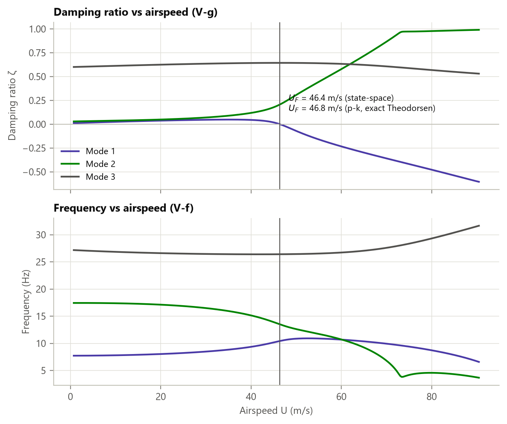

**Figure 2.** The same analysis for the NASA BACT wind-tunnel model.

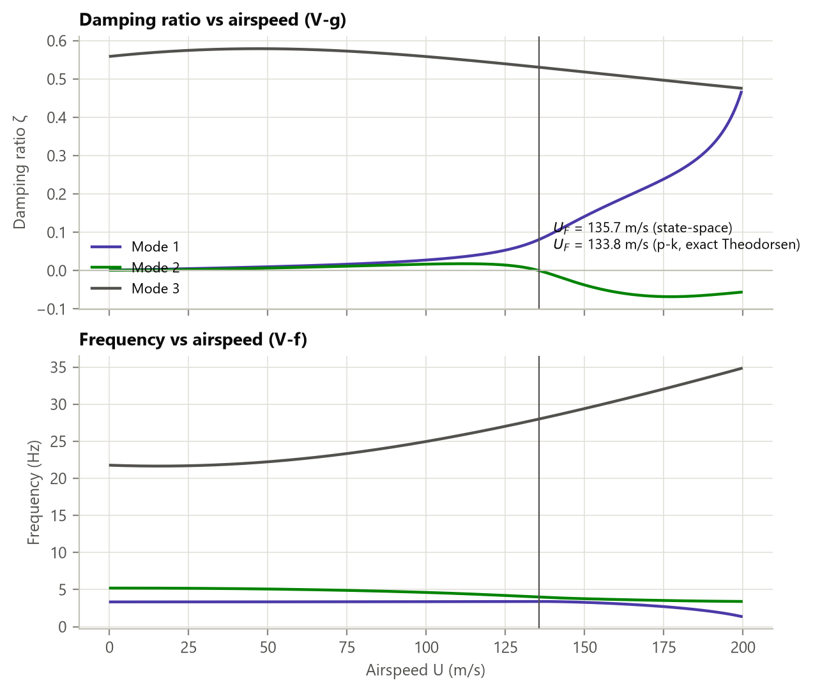

**Figure 3.** Time histories in turbulence at 1.1 U_F (seed 0): plunge, pitch, flap command and gust.

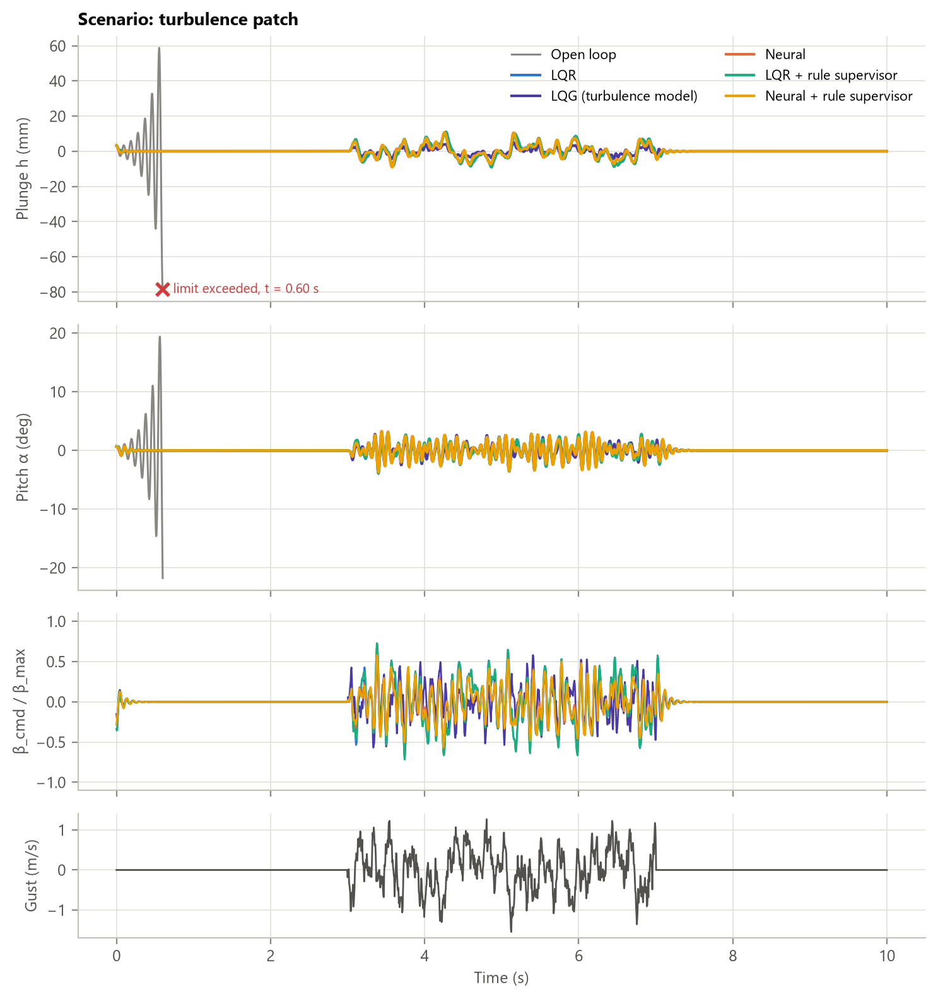

**Figure 4.** Effort–response trade-off at fixed aggressiveness (turbulence). A supervisor adds value only if its point lies below the curve of its controller.

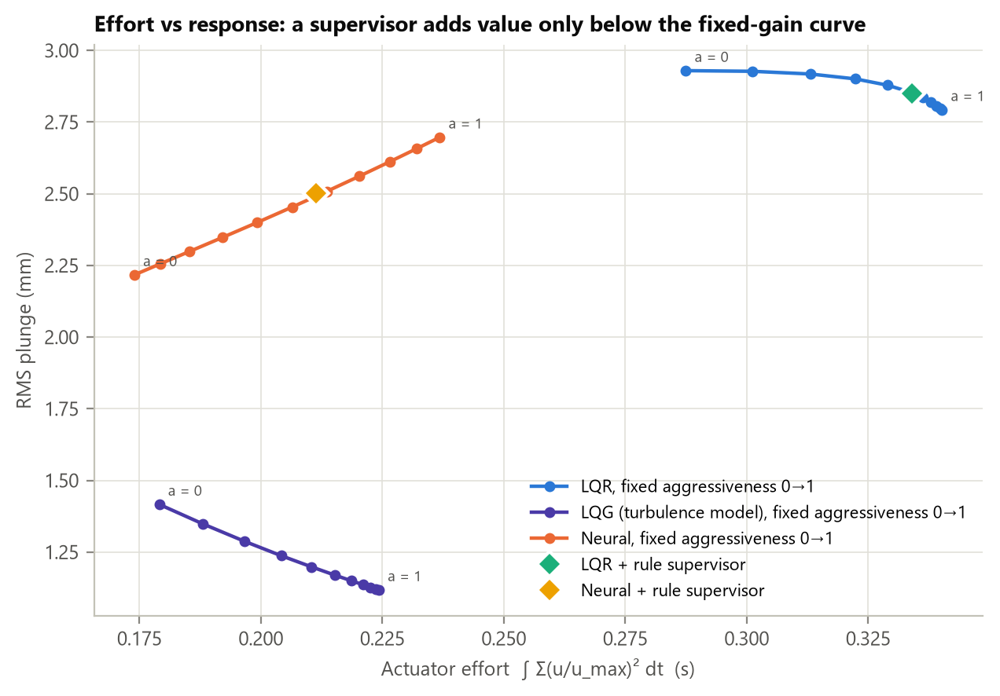

**Figure 5.** Tolerance to loop delay: designs re-computed for the true delay vs fixed designs.

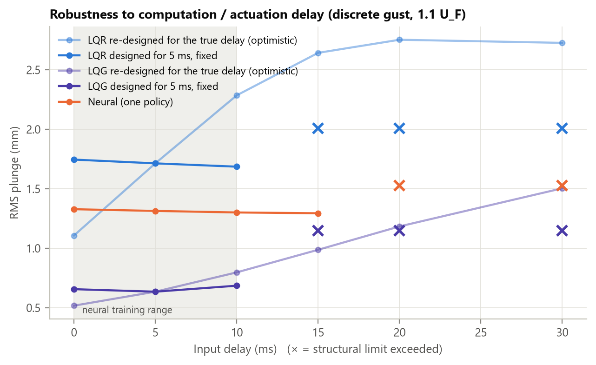

**Figure 6.** Robustness of designs made for the nominal wing: model error, sensor noise and actuator slew-rate limits.

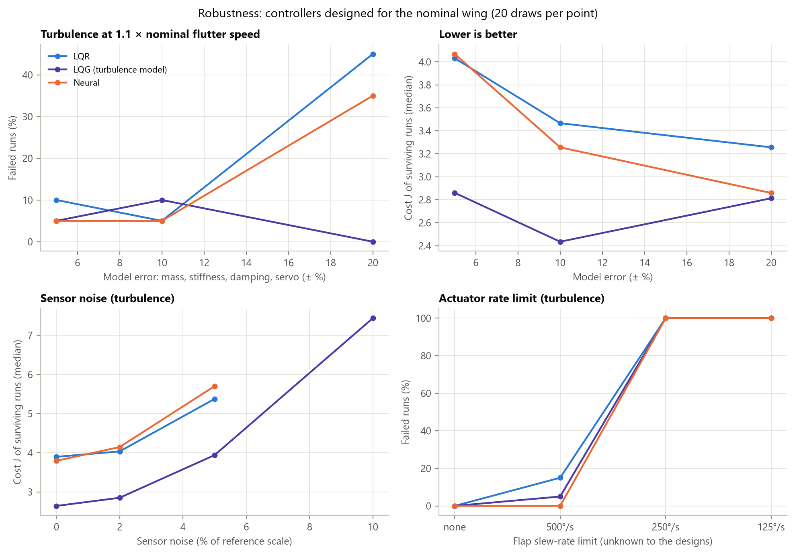

**Figure 7.** Neural policy training: imitation loss and differentiable-physics fine-tuning.

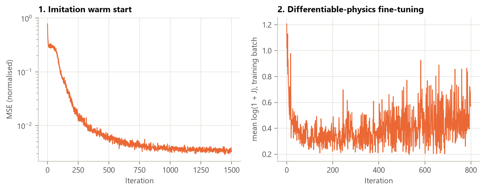

**Figure 8.** Local LLM supervisor choosing effort modes: latency per decision, and where supervised runs land relative to the fixed-aggressiveness curves.

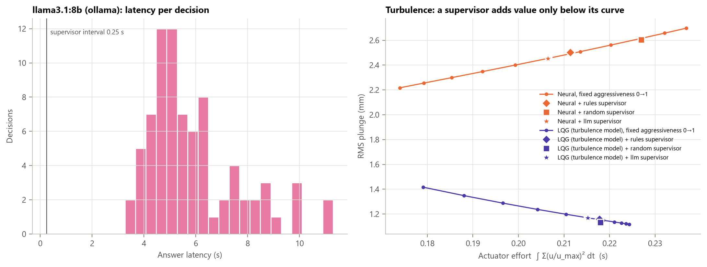

**Figure 9.** Fault-tolerant supervision: flights survived and time slowed down, per fault and supervisor.

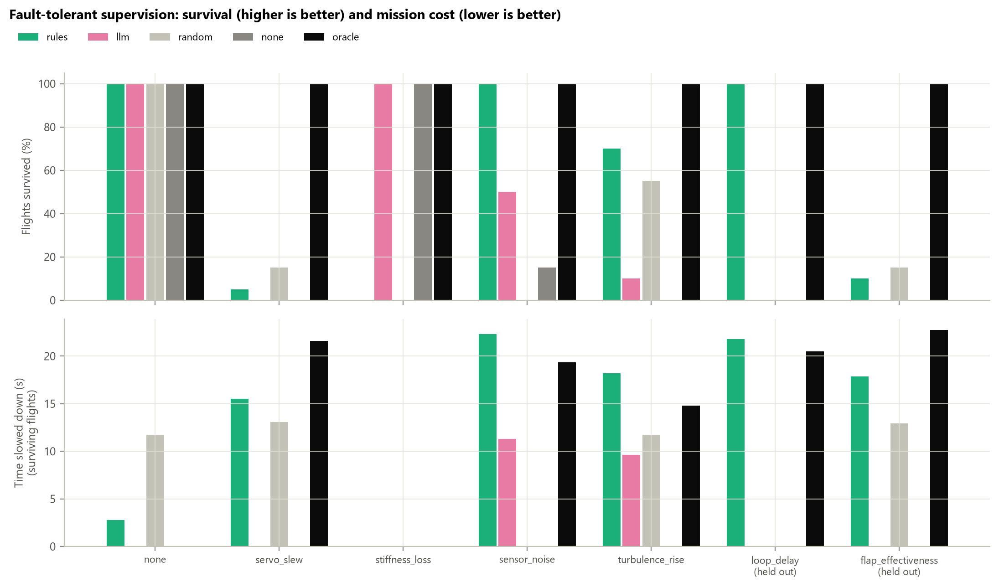

**Figure 10.** Pre-registered test of physics-informed supervision (seeds 100-119): rules and LLM with and without the on-board flutter-margin estimate.

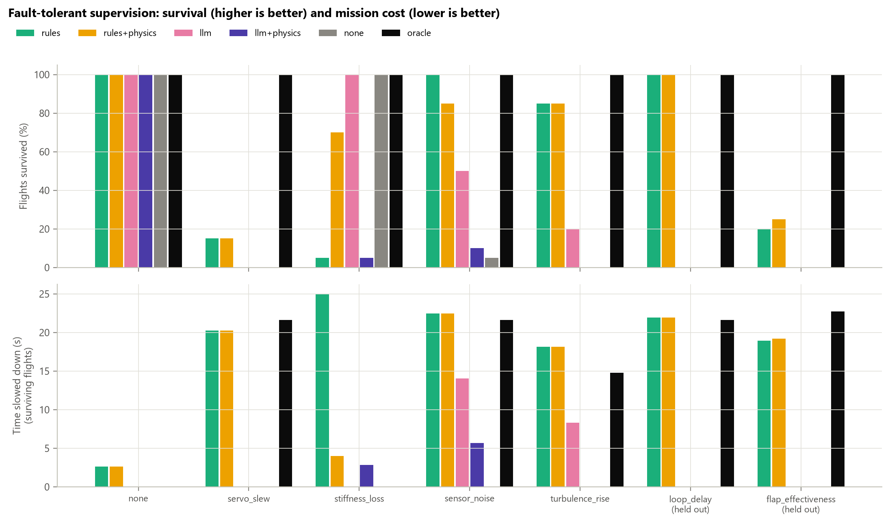

**Figure 11.** Learned fault diagnoser on held-out evaluation flights: detection of the known faults and the unknown-fault score on the two faults it never saw.

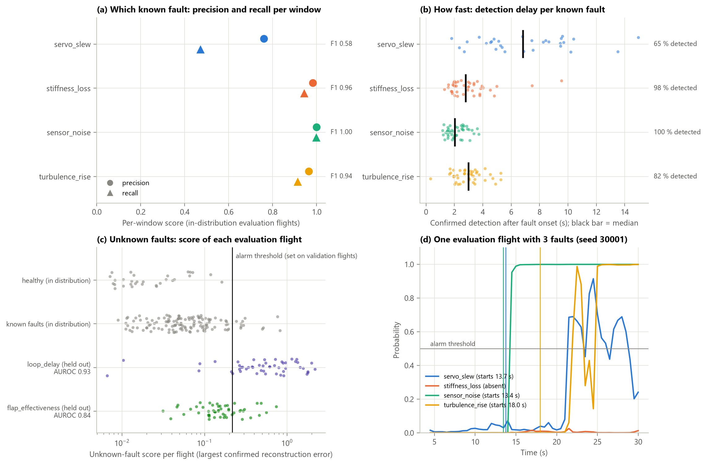

**Figure 12.** The guardian (learned diagnosis + physics admissibility, no language model) against the other supervisors on fresh seeds 300-319.

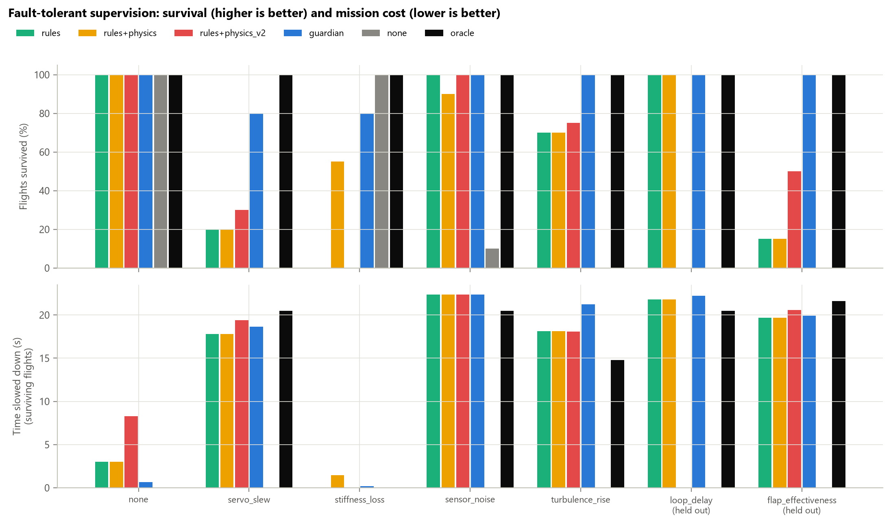

**Figure 13.** Post-flight LLM reviewer: each hypothesis (and each forced-wrong control) through the verification gate's checks, against the thresholds fixed in advance.

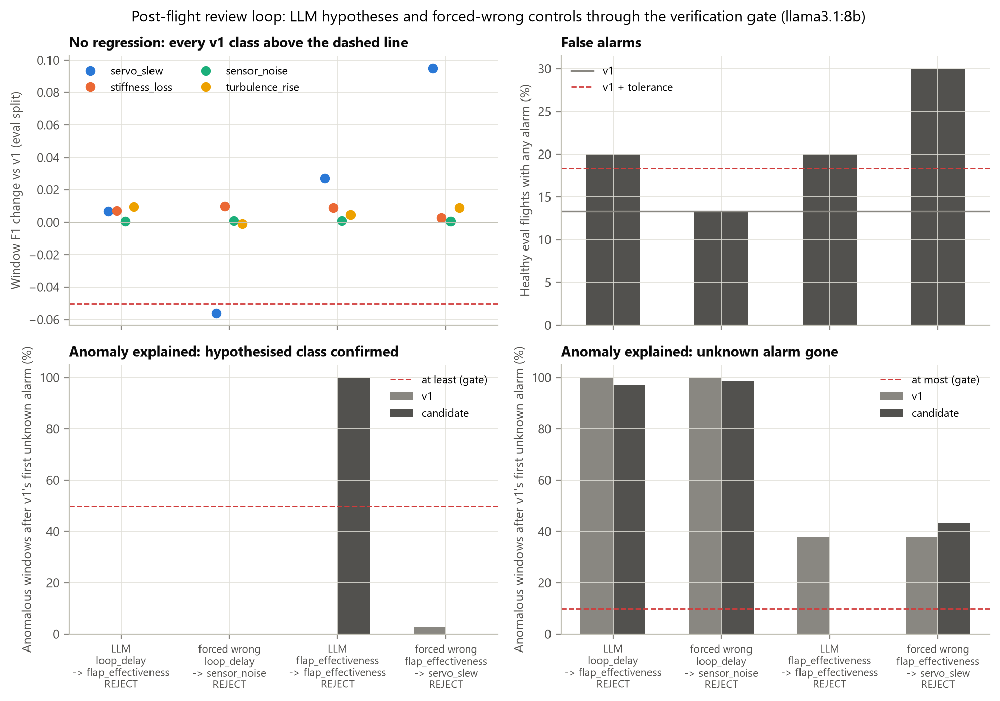

## References

- **Mukhopadhyay 1999** [mukhopadhyay1999]: Mukhopadhyay, Vivek. *Transonic Flutter Suppression Control Law Design, Analysis and Wind Tunnel Results*. International Forum on Aeroelasticity and Structural Dynamics (IFA).
- **Scott & Pado 2000** [scott2000]: Scott, Robert C.; Pado, Lawrence E. *Active Control of Wind-Tunnel Model Aeroelastic Response Using Neural Networks*. Journal of Guidance, Control, and Dynamics, 23(6), 1100–1108, doi:10.2514/2.4661.
- **Bernelli-Zazzera et al. 2000** [bernellizazzera2000]: Bernelli-Zazzera, Franco; Mantegazza, Paolo; Mazzoni, Giovanni; Rendina, Matteo. *Active Flutter Suppression Using Recurrent Neural Networks*. Journal of Guidance, Control, and Dynamics, 23(6), 1030–1036, doi:10.2514/2.4671.
- **Mattaboni et al. 2009** [mattaboni2009]: Mattaboni, Mattia; Quaranta, Giuseppe; Mantegazza, Paolo. *Active Flutter Suppression for a Three-Surface Transport Aircraft by Recurrent Neural Networks*. Journal of Guidance, Control, and Dynamics, 32(4), 1295–1307, doi:10.2514/1.40774.
- **Tang et al. 2018** [tang2018]: Tang, Difan; Chen, Lei; Tian, Zhao Feng; Hu, Eric. *Adaptive nonlinear optimal control for active suppression of airfoil flutter via a novel neural-network-based controller*. Journal of Vibration and Control, 24(22), 5261–5272, doi:10.1177/1077546317750504.
- **Tang et al. 2021** [tang2020]: Tang, Difan; Chen, Lei; Tian, Zhao Feng; Hu, Eric. *A neural network approach for improving airfoil active flutter suppression under control-input constraints*. Journal of Vibration and Control, 27(3–4), 451–467, doi:10.1177/1077546320929153.
- **Chen et al. 2023a** [chen2023rl]: Chen, Zhen; Shi, Zhiwei; Chen, Sinuo; Tong, Shengxiang; Dong, Yizhang. *Active flutter suppression for a flexible wing model with trailing-edge circulation control via reinforcement learning*. AIP Advances, 13(1), 015317, doi:10.1063/5.0130370.
- **Du & Chan 2026** [du2026survey]: Du, Haiping; Chan, Linping. *Large Language Models in the Loop: A Stability- and Network-Aware Survey in Networked Control, Cyber-Physical, and Multi-Agent Systems*. arXiv:2609.16599.
- **Vyas et al. 2026a** [vyas2026ftc]: Vyas, Javal; Gill, Milapji Singh; Markaj, Artan; Gehlhoff, Felix; Mercangöz, Mehmet. *From Detection to Action: Using LLM Agents for Fault-Tolerant Control*. arXiv:2606.28011.
- **Vyas et al. 2026b** [vyas2026tutorial]: Vyas, Javal; Gill, Milapji Singh; Markaj, Artan; Gehlhoff, Felix; Mercangöz, Mehmet. *A Tutorial on Autonomous Fault-Tolerant Control Using Knowledge-Grounded LLM Agents*. arXiv:2606.31635.
- **Papacharalampopoulos et al. 2026** [papacharalampopoulos2026]: Papacharalampopoulos, Alexios; Karagianni, Olga Maria; Stavropoulos, Panagiotis. *Cognitive Supervisory Control with LLM Reasoning Agent for Fault-Tolerant Process Systems: A Digital Twin Perspective*. Processes, 14(14), 2298, doi:10.3390/pr14142298.
- **Ahn et al. 2022** [ahn2022saycan]: Ahn, Michael; Brohan, Anthony; Brown, Noah; et al. *Do As I Can, Not As I Say: Grounding Language in Robotic Affordances*. arXiv:2204.01691.
- **Chen et al. 2023b** [chen2023typefly]: Chen, Guojun; Yu, Xiaojing; Ling, Neiwen; Zhong, Lin. *TypeFly: Flying Drones with Large Language Model*. arXiv:2312.14950.
- **Xu et al. 2022** [xu2022shac]: Xu, Jie; Makoviychuk, Viktor; Narang, Yashraj; et al. *Accelerated Policy Learning with Parallel Differentiable Simulation*. International Conference on Learning Representations (ICLR), arXiv:2204.07137.
- **Heeg et al. 2025** [heeg2024]: Heeg, Johannes; Song, Yunlong; Scaramuzza, Davide. *Learning Quadrotor Control From Visual Features Using Differentiable Simulation*. IEEE International Conference on Robotics and Automation (ICRA), arXiv:2410.15979.
- **Shibu et al. 2026** [shibu2026skysim]: Shibu, Aditya; Saleh, Marah; Al-Musleh, Mohamed; Abdulaziz, Nidhal. *SkySim: A ROS2-based Simulation Environment for Natural Language Control of Drone Swarms using Large Language Models*. 2nd International Conference on Drones and Unmanned Systems (DAUS 2026), arXiv:2602.01226.
- **Hespanha & Morse 1999** [hespanha1999]: Hespanha, João P.; Morse, A. Stephen. *Stability of switched systems with average dwell-time*. Proceedings of the 38th IEEE Conference on Decision and Control, 3, 2655–2660, doi:10.1109/CDC.1999.831330.
- **Doyle 1978** [doyle1978]: Doyle, John C. *Guaranteed margins for LQG regulators*. IEEE Transactions on Automatic Control, 23(4), 756–757, doi:10.1109/TAC.1978.1101812.
- **Theodorsen 1935** [theodorsen1935]: Theodorsen, Theodore. *General Theory of Aerodynamic Instability and the Mechanism of Flutter*. NACA, Report 496.
- **Waszak 1998** [waszak1998bact]: Waszak, Martin R. *Modeling the Benchmark Active Control Technology Wind-Tunnel Model for Active Control Design Applications*. NASA Langley Research Center, NASA/TP-1998-206270.
- **DSpower 2026** [dsw001a]: DSpower. *DS-W001A digital servo: specifications (no-load speed ≤ 0.11 s/60° at 12 V)*. Manufacturer web page, accessed 2026-09-29.

## Appendix: citation check (Rules.md §1.7)

Read these in full before submission (only their abstracts were read, or they were not opened):

- [bernellizazzera2000] read status: **abstract**
- [mattaboni2009] read status: **abstract**
- [tang2018] read status: **abstract**
- [tang2020] read status: **abstract**
